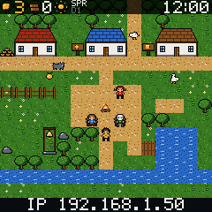
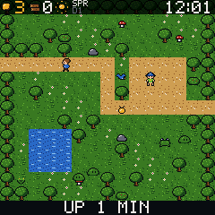
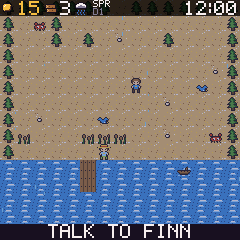
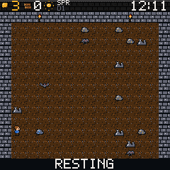
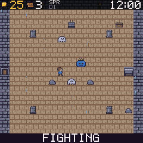
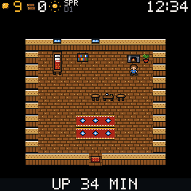
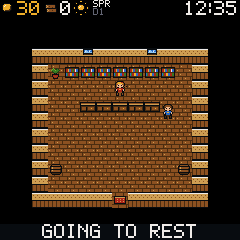
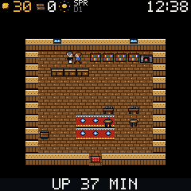

# GeekQuest

A self-playing pixel-art village game for the GeekMagic 240x240 ESP8266 clock. A small
adventurer takes breaks from questing to wander the village, chop wood, fish, trade and
chat. You never press anything: it is a clock with a little world in it. The top bar shows the
time, the real weather outside (icon and temperature for the place you choose) and the season. The
bottom band shows what the hero is doing right now, the clock's IP address and the uptime. At night
(or in the hours you choose) the hero goes to bed and the screen goes dark until the wake time.

**Download:** every build of the `main` branch is published on the
[Releases page](https://github.com/techconcert/GeekMagic/releases). Releases are named by number
(GeekQuest r5, **GeekQuest r6**, ...; the number lives in the `VERSION` file) and the newest is marked
"Latest". Each release has the two firmware files, `preview.html` (the game in your browser)
and `SHA256SUMS.txt`. The file names also carry the short commit, for example
`SDP_GeekQuest_quest_r6-1a2b3c4.bin`.

## What the game looks like

Screenshots from the preview (the same game core the clock runs), one per place the hero visits.

| Village | Forest | Shore | Cave |
|---|---|---|---|
|  |  |  |  |

| Ruins | Home | Shop | Tavern |
|---|---|---|---|
|  |  |  |  |

## Hardware

- GeekMagic SD Pro / SmallTV-style clock: ESP8266 (ESP-12, 4 MB flash) with a 240x240 ST7789
  display.
- Display wiring (from the [GeekMagic-Open-Firmware](https://github.com/Times-Z/GeekMagic-Open-Firmware)
  teardown): hardware SPI mode 3 at 40 MHz, MOSI 13, SCLK 14, DC 0, RST 2, CS tied to ground,
  backlight on GPIO 5 (active LOW).
- No serial adapter is needed or assumed. Everything is installed and recovered over WiFi.

## Builds

| File | What it is |
|---|---|
| `SDP_GeekQuest_quest_<version>.bin` | The game. |
| `SDP_GeekQuest_test_<version>.bin` | Display test: grass field, walking hero, RGB colour bars, FPS. Flash this first if you are unsure about colours. |

The names start with `SDP` because the stock updater only accepts such names.

## How to flash (over WiFi, no cable)

**First time, from the stock firmware:** open the clock's own web page, go to its firmware update
page and choose `SDP_GeekQuest_test_....bin` (or the quest file). Wait for the clock to restart.

**Later, from GeekQuest:** open `http://<clock IP>/update` (the IP address is on the clock's
bottom band and on your router's list), choose the new `.bin` and press **Upload and install**.
The page checks the file before uploading and shows its CRC32; the clock verifies the image again
before switching over. A failed or interrupted upload leaves the running firmware untouched.

Read [docs/RECOVERY.md](docs/RECOVERY.md) once, before the first install.

## The clock's web pages

Open `http://<clock IP>/`. The status page shows firmware, WiFi, network health, memory and
uptime. **Update firmware** and **Clock settings** are buttons in the first tile, **WiFi setup** is
in the Network tile.

**Update firmware** (`/update`): choose a `.bin` by hand, or press **Check for a new version**: your
browser (not the clock) asks GitHub for `latest.json` on the `builds` branch, tells you if a newer
build exists, and **Download it** loads the file into the page for you; you then press **Upload and
install**. The clock itself never talks to GitHub. The same checks run on the file as for a manual upload.

**Clock settings** (`/config`):

- **Weather:** search a city (foreign places work), or type latitude and longitude. Celsius is the
  default, Fahrenheit is an option. The clock asks [Open-Meteo](https://open-meteo.com/) (free, no
  account, plain HTTP) every 30 minutes and shows the icon and temperature on the top bar; the game
  weather follows it.
- **Sleep:** a sleep time and a wake time. The hero walks home and goes to bed, the screen and
  game go dark, the CPU slows down, and the clock keeps the time. At the wake time everything
  comes back by itself with the hero up. **Sleep now** and **Wake now** buttons are there too.
  WiFi, the web pages and the update page stay on while asleep.
- **Location and time zone:** the city search also fills the time zone rule (converted in your
  browser, no firmware cost); you can still type the rule text by hand.
- **Screen:** brightness, colour depth, the weekly maintenance restart and the display test.
- **Save settings** and **Reset these settings** on this page touch only this page's settings.

The status page has a **Game settings** section (info card interval, quiet at night) with its own
Apply and **Reset game settings** buttons, which touch only those two settings.

**Settings and the game survive a power cut** (R5): see "Saving to flash" below.

## Recovery and the rescue hotspot

Every build contains, and CI refuses to produce a `.bin` without (`tools/check_bin.py`):

- **The update page starts first.** WiFi and the web server start before the display or the game,
  so a game bug cannot hide the update page.
- **Rescue hotspot** `GEEKQUEST-XXXX`, password `GEEKQUEST`, at `http://192.168.4.1/`. It is on for
  the first 10 minutes after every power-on and whenever the clock cannot find your WiFi. The
  WiFi page (`/wifi`) lets you enter your network again.
- **Crash-loop safe mode.** After 3 crashes in a row (or 5 in total without 6 hours of uptime in
  between) the clock boots without the game and shows SAFE MODE; after 6 it also skips the
  display. The update page still works.
- **Automatic restarts** (approved in R2): after hours without WiFi, with very low memory, and once
  a week at night. They never happen while a firmware upload is running, are rate limited, and
  count towards safe mode like any restart.
- **Size limit.** The ESP8266 holds the running firmware while receiving the next one, both inside
  a 1 MB area. CI fails any build over 500 KB, so updates always fit, including going back to
  stock.
- **Stock files are never touched.** Same flash layout as the stock firmware; the code never writes
  flash by itself (only the update page's Updater does), and CI forbids EEPROM, LittleFS and SPIFFS
  code. Flashing `SDPro_V1.0.6_....bin` from the GeekQuest update page brings the original clock
  back.
- **One flash area, approved by the owner.** Since R5 the clock saves its settings and the game in
  sectors 0x80000-0x82FFF (three 4 KB sectors, between the running image and a staged update).
  Nothing else is ever written: not 0x3FA000 (stock data), not 0xFF000, no EEPROM, LittleFS or
  SPIFFS. CI enforces this (`tools/lint_safety.py` rules L2 and L14). See "Saving to flash".

## Saving to flash

`firmware/store.cpp` keeps a ring log of 320-byte records (settings, weather and sleep settings, game)
in 36 slots over the three sectors. Each record has a CRC and a sequence number; the newest valid
one is loaded at boot, so a power cut in the middle of a write can never produce a half-saved state
(tested with random power cuts, see `test/test_slotlog.cpp`). Writes are rare: settings 5 seconds
after a change, the game every 20 minutes and at each new game day, at most 6 writes in 10 minutes;
every write is read back and 3 failures switch saving off. Nothing is written in safe mode, while a
firmware update runs, or when the image is larger than 0x7D000 bytes. After 2 or more crashes the
saved game is kept aside, not loaded, so a game that crashes the clock cannot crash it again from
the save. Updating to a new GeekQuest build keeps everything; flashing the stock firmware does not
(not needed). The status page shows "Saved to flash ..." or "Loaded from flash ..." lines.

Gates: `tools/lint_safety.py`, `tools/check_bin_selftest.py`, `tools/check_bin.py` on every `.bin`,
a size report, and `tools/recovery_guard.py` (a `RECOVERY-CHANGE:` commit line and a new
`GQ_RECOVERY_REV` whenever a recovery file changes).

## Build and test

Firmware (PlatformIO, ESP8266 Arduino core):

```
pio run -e quest        # the game  -> dist/SDP_GeekQuest_quest_<version>.bin
pio run -e test         # display test build (the only one with the test scene)
```

Host tests (no ESP8266 needed; run every `test/*.cpp`, `test_world` and `test_soak` take minutes):

```
for t in test/*.cpp; do
  g++ -std=c++17 -O1 -g -fsanitize=address,undefined -fno-sanitize-recover=all -Wall -Wextra -Werror \
    -o /tmp/$(basename $t .cpp) $t lib/gamecore/src/*.cpp lib/gqsafe/src/*.cpp && /tmp/$(basename $t .cpp)
done
python3 tools/lint_safety.py && python3 tools/lint_safety.py --selftest
python3 tools/check_bin_selftest.py
```

Browser preview (clang with wasm32 and lld): `tools/build_preview.sh` writes `preview/dist/index.html`.
The preview is the same game core as the clock, plus a debug panel that is not in the firmware: pick
the season, weather, a festival, live weather and sleep mode, start any quest, open the info cards,
and **send the hero on a mission** (cave, shop, forest, fishing, bed and so on) to see each scene.

Art: tiles and sprites are `assets/src/*.png` on a 16x16 grid with the 16-colour palette in
`tools/palette.py`. After editing run `python tools/png2tiles.py`.

## Repository layout

```
firmware/        ESP8266 entry (main.cpp), ST7789 driver, recovery layer (safety.cpp, netwatch.cpp), prefs.cpp,
                 weather (wxnet.cpp), sleep schedule (nightmode.cpp), settings page (config.cpp)
lib/gamecore/    portable game core (no heap, no libc), used by the firmware and the preview
lib/gqsafe/      pure decision code of the recovery layer (boot counters, WiFi ladder, upload checks)
assets/src/      editable PNG sheets
tools/           asset converter, version stamp, .bin safety checks, source lint, CI guards
content/talk/    villager dialogue scripts (compiled into the firmware by tools/gen_talk.py)
firmware/config_page.h  source of the /config page; the firmware serves the gzip copy in config_page_gz.h (run tools/gen_config_gz.py after editing it, CI verifies)
docs/            design notes (DESIGN.md, DESIGN-R3.md), the owner's recovery guide
preview/         browser preview (WebAssembly)
test/            host tests
```

## How it draws

No full framebuffer (115 KB would not fit). The screen is 15 strips of 240x16 pixels; only strips
that changed are redrawn and sent. Art is stored as 4-bit indexed tiles in flash and expanded
through a 16-colour palette, which also makes the day/night tints cheap.

## License

Public domain: [CC0 1.0 Universal](LICENSE). No rights reserved.
